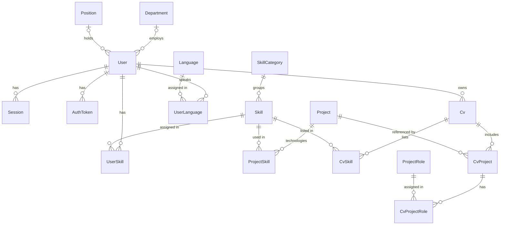

# Data model

Database schema for the CV Builder backend: entities, relations, deletion policies and constraints.
The source of truth is the Prisma schema in [`backend/prisma/schema/`](../backend/prisma/schema/);
this document explains it and records the decisions behind it.

Requirements come from the CV Builder Wiki (Notion): the "Database Model" / "Database Requirements"
sections of each page.

## Schema files

The schema is split into one file per domain. Prisma merges all `.prisma` files in the folder,
so models reference each other across files without imports.

| File                | Models                                                | Owning module |
| ------------------- | ----------------------------------------------------- | ------------- |
| `schema.prisma`     | `generator`, `datasource`                             | —             |
| `enums.prisma`      | `UserRole`, `Mastery`, `Proficiency`, `AuthTokenType` | shared        |
| `user.prisma`       | `User`, `Session`, `AuthToken`                        | Auth + Users  |
| `department.prisma` | `Department`                                          | Departments   |
| `position.prisma`   | `Position`                                            | Positions     |
| `skill.prisma`      | `Skill`, `SkillCategory`, `UserSkill`                 | Skills        |
| `language.prisma`   | `Language`, `UserLanguage`                            | Languages     |
| `project.prisma`    | `Project`, `ProjectRole`, `ProjectSkill`              | Projects      |
| `cv.prisma`         | `Cv`, `CvSkill`, `CvProject`, `CvProjectRole`         | CVs           |

Rule: a join table lives in the file of the module that writes it
(e.g. `ProjectSkill` is filled by `createProject`/`updateProject`, so it lives in `project.prisma`).

## ER diagram



## Entities

All tables have `id` (uuid), `created_at` and `updated_at`. Only the meaningful columns are listed below.

### Auth & users

| Table         | Columns                                                                                                                                                          |
| ------------- | ---------------------------------------------------------------------------------------------------------------------------------------------------------------- |
| `users`       | `email` citext, `password_hash`, `role` (`EMPLOYEE`/`ADMIN`), `email_verified_at?`, `first_name?`, `last_name?`, `avatar_url?`, `department_id?`, `position_id?` |
| `sessions`    | `user_id`, `token_hash` (refresh token), `user_agent?`, `expires_at`, `revoked_at?`                                                                              |
| `auth_tokens` | `user_id`, `type` (`EMAIL_VERIFICATION`/`PASSWORD_RESET`), `code_hash`, `expires_at`, `used_at?`                                                                 |

- Profile fields are nullable: Sign Up collects only email and password. "Create user" by an Admin requires
  first/last name, department and position; this is enforced by the input DTO, not by the DB.
- `email_verified_at` is the email verification status (`null` = not verified).
- `avatar_url` stores a reference to the uploaded file, never the image itself.
- `auth_tokens` covers both the 6-digit email verification code (10 min, single-use, a new code invalidates the
  previous one) and the password reset token. Only hashes are stored; `code_hash` is not unique because two users
  can get the same 6-digit code. Lookup is by `(user_id, type)`.

### Catalogs

| Table              | Columns                                                                                                     |
| ------------------ | ----------------------------------------------------------------------------------------------------------- |
| `departments`      | `name` citext                                                                                               |
| `positions`        | `name` citext                                                                                               |
| `skill_categories` | `name` citext, `type` varchar(100)                                                                          |
| `skills`           | `name` citext, `category_id`                                                                                |
| `languages`        | `name` citext, `iso` varchar(5), `native_name`                                                              |
| `projects`         | `name` varchar(100), `domain` varchar(100), `start_date` date, `end_date` date, `description` varchar(2000) |
| `project_roles`    | `name` citext                                                                                               |

- **Skill type** is a column of the category (e.g. category "Databases" has type "Backend"). The Skills table
  shows it as `skill.category.type`; the admin picks only the category, and the type follows from it.
- **Language ISO** is normalized to upper case (`EN`) by the service before saving.
- **Project roles** ("Frontend Developer", "Team Lead") are a seed-only catalog: the spec has no admin page for them.

### Assignments

| Table              | Columns                                                                         |
| ------------------ | ------------------------------------------------------------------------------- |
| `user_skills`      | `user_id`, `skill_id`, `mastery` (`NOVICE` … `EXPERT`)                          |
| `user_languages`   | `user_id`, `language_id`, `proficiency` (`A1` … `C2`, `NATIVE`)                 |
| `project_skills`   | `project_id`, `skill_id` (project technologies)                                 |
| `cvs`              | `user_id`, `name` varchar(255), `education` varchar(255), `description`         |
| `cv_skills`        | `cv_id`, `skill_id`                                                             |
| `cv_projects`      | `cv_id`, `project_id`, `start_date` date, `end_date?` date, `responsibilities?` |
| `cv_project_roles` | `cv_project_id`, `role_id`                                                      |

- `cv_projects.end_date = null` means "Till now". In the `projects` catalog `end_date` is required.
- Project name, domain, description and technologies shown on a CV come from the referenced `projects` row;
  only participation dates, responsibilities and roles are CV-specific.

## Deletion policy

The spec asks each catalog to define its deletion policy explicitly. One rule is used everywhere:

- **A catalog item cannot be deleted while something references it** (`Restrict`). The API returns a business
  error, e.g. "Skill cannot be deleted because it is assigned to users".
- **Deleting an owner removes its own links** (`Cascade`). Global catalog items are never deleted as a side effect.

| Relation (FK)                                  | On delete of the referenced row | Effect                                               |
| ---------------------------------------------- | ------------------------------- | ---------------------------------------------------- |
| `users.department_id` → departments            | Restrict                        | Department in use cannot be deleted                  |
| `users.position_id` → positions                | Restrict                        | Position in use cannot be deleted                    |
| `sessions.user_id` → users                     | Cascade                         | Deleting a user removes their sessions               |
| `auth_tokens.user_id` → users                  | Cascade                         | Deleting a user removes their codes/tokens           |
| `skills.category_id` → skill_categories        | Restrict                        | Category with skills cannot be deleted               |
| `user_skills.user_id` → users                  | Cascade                         | Deleting a user removes their skill assignments      |
| `user_skills.skill_id` → skills                | Restrict                        | Skill assigned to a user cannot be deleted           |
| `user_languages.user_id` → users               | Cascade                         | Deleting a user removes their language assignments   |
| `user_languages.language_id` → languages       | Restrict                        | Language assigned to a user cannot be deleted        |
| `project_skills.project_id` → projects         | Cascade                         | Deleting a project removes its technology links      |
| `project_skills.skill_id` → skills             | Restrict                        | Skill used as a project technology cannot be deleted |
| `cvs.user_id` → users                          | Cascade                         | Deleting a user removes their CVs                    |
| `cv_skills.cv_id` → cvs                        | Cascade                         | Deleting a CV removes its skill links                |
| `cv_skills.skill_id` → skills                  | Restrict                        | Skill used in a CV cannot be deleted                 |
| `cv_projects.cv_id` → cvs                      | Cascade                         | Deleting a CV removes its projects                   |
| `cv_projects.project_id` → projects            | Restrict                        | Project used in a CV cannot be deleted               |
| `cv_project_roles.cv_project_id` → cv_projects | Cascade                         | Deleting a CV project removes its roles              |
| `cv_project_roles.role_id` → project_roles     | Restrict                        | Role used in a CV cannot be deleted                  |

## Constraints

### Uniqueness

`citext` makes uniqueness case-insensitive (`React` and `react` are the same department).

| Spec rule                                  | DB constraint                                          |
| ------------------------------------------ | ------------------------------------------------------ |
| Email must be unique                       | `users.email` unique, citext                           |
| Department / Position name is unique       | `departments.name`, `positions.name` unique, citext    |
| Skill name must be unique                  | `skills.name` unique, citext                           |
| Category names are not duplicated          | `skill_categories.name` unique, citext                 |
| Language name and ISO must be unique       | `languages.name` unique citext, `languages.iso` unique |
| A user cannot have the same skill twice    | `user_skills (user_id, skill_id)` unique               |
| A user cannot have the same language twice | `user_languages (user_id, language_id)` unique         |
| No duplicate technologies in a project     | `project_skills (project_id, skill_id)` unique         |
| No duplicate skills in a CV                | `cv_skills (cv_id, skill_id)` unique                   |
| A project is not duplicated in the same CV | `cv_projects (cv_id, project_id)` unique               |
| No duplicate roles for the same CV project | `cv_project_roles (cv_project_id, role_id)` unique     |
| Refresh token is unique                    | `sessions.token_hash` unique                           |

### Length limits

| Spec rule                      | Column type                                        |
| ------------------------------ | -------------------------------------------------- |
| First / Last name: max 100     | `users.first_name`, `users.last_name` varchar(100) |
| CV name / education: max 255   | `cvs.name`, `cvs.education` varchar(255)           |
| Project name / domain: max 100 | `projects.name`, `projects.domain` varchar(100)    |
| Project description: max 2000  | `projects.description` varchar(2000)               |
| Language ISO: max 5            | `languages.iso` varchar(5)                         |

The same limits are validated in the input DTOs, so the client gets a validation error instead of a DB error.

### Rules enforced outside Prisma

Prisma cannot express these; they are added by hand to the initial migration (Foundation task)
or checked in services.

| Rule                                                                         | Where                                                                                                                          |
| ---------------------------------------------------------------------------- | ------------------------------------------------------------------------------------------------------------------------------ |
| `citext` extension must exist                                                | First line of the initial `migration.sql`: `CREATE EXTENSION IF NOT EXISTS citext;`                                            |
| Project `start_date <= end_date`                                             | `ALTER TABLE "projects" ADD CONSTRAINT "projects_dates_check" CHECK ("start_date" <= "end_date");`                             |
| CV project `start_date <= end_date` (if end date is set)                     | `ALTER TABLE "cv_projects" ADD CONSTRAINT "cv_projects_dates_check" CHECK ("end_date" IS NULL OR "start_date" <= "end_date");` |
| CV project dates are within the project's dates                              | Service (a CHECK cannot reference another table)                                                                               |
| CV skills belong to the CV owner's skills                                    | Service                                                                                                                        |
| Names are trimmed, repeated spaces collapsed; ISO upper-cased                | Service (normalization before save)                                                                                            |
| A new verification code invalidates the previous one; resend is rate-limited | Service                                                                                                                        |

Create the initial migration without applying it, add the SQL above, then apply it:

```bash
pnpm db:migrate --name init --create-only
# edit backend/prisma/migrations/<timestamp>_init/migration.sql
pnpm db:migrate
```

## Decisions

- **Restrict over soft delete.** The spec allows restrict, cascade or soft delete. Restrict is the simplest
  to implement and explain; soft delete can be added later per catalog (`is_active` flag) if needed.
- **Single `users` table for auth and profile.** Profile is 1:1 with the account and has no life of its own.
- **Skill type is a string column of `skill_categories`**, as the spec describes the category ("Category name,
  Skill type"). It is a string rather than an enum, so new types can be added through the seed without a migration.
  A category tree (type = parent category) was considered and rejected: it needs an extra service rule
  ("skills reference second-level categories only") and a self-relation.
- **Project technologies reference `skills`.** Technologies come from a managed catalog; skills already are one.
  The relation is named `technologies` (as in the wiki GraphQL examples); "Environment" is only the UI label.
- **Project name is not unique.** The spec requires it only to be present. Revisit if the team decides otherwise.
- **User preferences (theme, language) are not stored.** The spec allows keeping them on the client.
- **`responsibilities` is a single text field** (a textarea in the spec), not an array.
