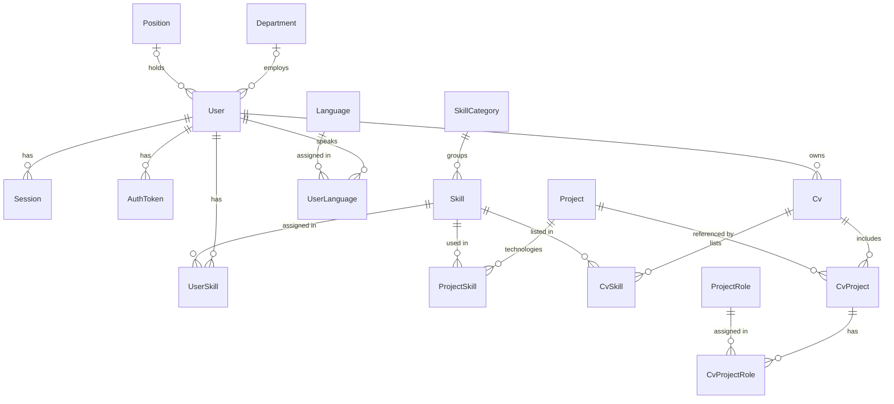

# Data model

Database schema for the CV Builder backend: entities, relations, deletion policies and constraints.
The source of truth is the Prisma schema in [`backend/prisma/schema/`](../backend/prisma/schema/);
this document explains it and records the decisions behind it.

Requirements come from the CV Builder Wiki (Notion): the "Database Model" / "Database Requirements"
sections of each page.

## Schema files

The schema is split into one file per domain. Prisma merges all `.prisma` files in the folder,
so models reference each other across files without imports.

| File                | Models                                                | Owning module |
| ------------------- | ----------------------------------------------------- | ------------- |
| `schema.prisma`     | `generator`, `datasource`                             | —             |
| `enums.prisma`      | `UserRole`, `Mastery`, `Proficiency`, `AuthTokenType` | shared        |
| `user.prisma`       | `User`, `Session`, `AuthToken`                        | Auth + Users  |
| `department.prisma` | `Department`                                          | Departments   |
| `position.prisma`   | `Position`                                            | Positions     |
| `skill.prisma`      | `Skill`, `SkillCategory`, `UserSkill`                 | Skills        |
| `language.prisma`   | `Language`, `UserLanguage`                            | Languages     |
| `project.prisma`    | `Project`, `ProjectRole`, `ProjectSkill`              | Projects      |
| `cv.prisma`         | `Cv`, `CvSkill`, `CvProject`, `CvProjectRole`         | CVs           |

Rule: a join table lives in the file of the module that writes it
(e.g. `ProjectSkill` is filled by `createProject`/`updateProject`, so it lives in `project.prisma`).

## ER diagram



## Entities

All tables have `id` (uuid), `created_at` and `updated_at`. Only the meaningful columns are listed below.

### Auth & users

| Table         | Columns                                                                                                                                                          |
| ------------- | ---------------------------------------------------------------------------------------------------------------------------------------------------------------- |
| `users`       | `email` citext, `password_hash`, `role` (`EMPLOYEE`/`ADMIN`), `email_verified_at?`, `first_name?`, `last_name?`, `avatar_key?`, `department_id?`, `position_id?` |
| `sessions`    | `user_id`, `token_hash` (refresh token), `user_agent?`, `expires_at`, `revoked_at?`                                                                              |
| `auth_tokens` | `user_id`, `type` (`EMAIL_VERIFICATION`/`PASSWORD_RESET`), `code_hash`, `expires_at`, `used_at?`                                                                 |

- Profile fields are nullable: Sign Up collects only email and password. "Create user" by an Admin requires
  first/last name, department, position and role; this is enforced by the input DTO, not by the DB.
- `email_verified_at` is the email verification status (`null` = not verified).
- `avatar_key` stores the key of the uploaded file in the S3-compatible storage (MinIO locally, R2 or AWS in
  production), never the image itself and never its full URL. The API builds `User.avatarUrl` from the key and
  `S3_PUBLIC_URL`, so moving the files to another host needs only a config change. Replacing or removing the
  avatar and deleting the user also delete the file.
- `auth_tokens` covers both the 6-digit email verification code (10 min, single-use, a new code invalidates the
  previous one) and the password reset token. Only hashes are stored; `code_hash` is not unique because two users
  can get the same 6-digit code. Lookup is by `(user_id, type)`.

### Catalogs

| Table              | Columns                                                                                                     |
| ------------------ | ----------------------------------------------------------------------------------------------------------- |
| `departments`      | `name` citext                                                                                               |
| `positions`        | `name` citext                                                                                               |
| `skill_categories` | `name` citext, `type` varchar(100)                                                                          |
| `skills`           | `name` citext, `category_id`                                                                                |
| `languages`        | `name` citext, `iso` varchar(5), `native_name`                                                              |
| `projects`         | `name` varchar(100), `domain` varchar(100), `start_date` date, `end_date` date, `description` varchar(2000) |
| `project_roles`    | `name` citext                                                                                               |

- **Skill type** is a column of the category (e.g. category "Databases" has type "Backend"). The Skills table
  shows it as `skill.category.type`; the admin picks only the category, and the type follows from it.
- **Language ISO** is normalized to upper case (`EN`) by the input DTO before validation and saving.
- **Project roles** ("Frontend Developer", "Team Lead") are a seed-only catalog: the spec has no admin page for them.

### Assignments

| Table              | Columns                                                                         |
| ------------------ | ------------------------------------------------------------------------------- |
| `user_skills`      | `user_id`, `skill_id`, `mastery` (`BEGINNER` … `EXPERT`)                        |
| `user_languages`   | `user_id`, `language_id`, `proficiency` (`A1` … `C2`, `NATIVE`)                 |
| `project_skills`   | `project_id`, `skill_id` (project technologies)                                 |
| `cvs`              | `user_id`, `name` varchar(255), `education` varchar(255), `description`         |
| `cv_skills`        | `cv_id`, `skill_id`, `mastery` (`BEGINNER` … `EXPERT`)                          |
| `cv_projects`      | `cv_id`, `project_id`, `start_date` date, `end_date?` date, `responsibilities?` |
| `cv_project_roles` | `cv_project_id`, `role_id`                                                      |

- `cv_projects.end_date = null` means "until the end of the participation". In the `projects` catalog `end_date`
  is required, so the empty value is resolved when it is shown (CV Projects table, Preview, PDF, last used year)
  and never stored:
  - the catalog project is still running (its `end_date` is today or later): "Till now" / "Present";
  - the catalog project has ended (its `end_date` is before today): the project's `end_date`.

  So a CV project does not stay "Till now" after its project ends, and old rows need no migration. "Today" is
  the user's local day on the frontend and the UTC day on the backend (dates are stored as UTC midnight). The
  helpers are `effectiveEndDate` in `frontend/src/features/cv-projects/lib/` and `backend/src/cvs/cv-projects/`.
  Sorting by end date uses the same effective date, so the order matches what the table shows: "Till now" is
  the latest (last on `asc`, first on `desc`), equal dates go by `id ASC`. Prisma cannot sort by a computed
  value, so `cvProjects` sorts its rows in memory for `sortBy: endDate`; the list of one CV is small and not
  paginated. The backend takes "today" in UTC and the table in the user's time zone, so for a project that ends
  that very day the sort and the shown value can differ for a few hours around midnight.

- CV project dates stay within the dates of the catalog project. `createCvProject` / `updateCvProject` check the
  CV dates; `updateProject` rejects new project dates that would leave a CV project outside them
  (`BAD_USER_INPUT` on `startDate` / `endDate`, reason `USED_IN_CVS`). The CVs are never moved to fit the new
  dates: they belong to their owners, so the CV projects have to be edited first. An empty CV end date ends with
  the project and never blocks the change.
- The Add project form fills Start Date with the start of the chosen project and leaves End Date empty
  ("Till now", resolved as above), decided 2026-11-27: the wiki lists the project dates next to the
  auto-populated fields but its AC-8 names only Domain, Description and Environment. Choosing another project
  replaces Start Date and checks a picked End Date again.

- Project name, domain, description and technologies shown on a CV come from the referenced `projects` row;
  only participation dates, responsibilities and roles are CV-specific.
- `cv_projects.responsibilities` is one optional text, one responsibility per line (decided 2026-11-19). The wiki
  edits it in a single textarea, Figma shows each responsibility as a chip, so the frontend splits the text by
  line breaks. The input is trimmed; a blank value is saved as `null`.
- Every project role counts as active: the wiki's Add project modal lists "active roles", but roles are a
  seed-only catalog without an `is_active` flag, so `projectRoles` returns them all.

## CV preview

The Preview tab and the PDF export show the same data: both read it from `CvPreviewService` (query
`cvPreview(id)`). Nothing is stored for the preview: every value below is derived from the tables above
when the CV is requested.

The only required data are the CV name, education and description (validated on create and update). A CV
without skills, languages or projects is complete: the Preview hides those sections and the PDF can be
exported (mentor, 24.11.2026).

### Where each part comes from

| Part                   | Source                                                                           |
| ---------------------- | -------------------------------------------------------------------------------- |
| Name, position         | the CV owner (`users`, `positions`); the position can be missing                 |
| Education, name, desc. | `cvs`                                                                            |
| Language proficiency   | all `user_languages` of the CV owner; a CV has no languages of its own           |
| Domains                | distinct `projects.domain` of the CV projects                                    |
| Skills                 | `cv_skills`, grouped by skill category; categories without CV skills are omitted |
| Projects               | `cv_projects` with their catalog `projects` row, roles and technologies          |
| Experience, last used  | calculated per CV skill, see below                                               |

### Experience and last used year

Both values are calculated for every CV skill from **the projects of this CV only**, using the **CV-specific
dates** (`cv_projects.start_date` / `end_date`), not the dates of the catalog project. A project counts for a
skill when the skill is one of its technologies (`project_skills`, "Environment" in the UI); the match is by
skill id.

- **Experience in years** = full years from the start date of the earliest matching project until today
  (rounded down, month and day included: 01.06.2023 → 24.11.2026 is 3 years).
  - Less than a year gives `0`.
  - Periods are not summed: overlapping or parallel projects do not add up, only the earliest start counts.
- **Last used year** = the end year of the latest matching project, an empty end date resolved as described in
  [Assignments](#assignments) above. A project still "Till now" counts as the current year, so it wins over any
  finished one; a CV project without an end date whose catalog project has ended counts as the year the project
  ended.
- A CV skill that is in no CV project gets `null` for both values (an empty cell in the table).

Example (today: 2026-11-24):

| CV project | Start      | End        | Technologies      |
| ---------- | ---------- | ---------- | ----------------- |
| P1         | 2022-03-01 | 2023-12-31 | React, JavaScript |
| P2         | 2023-06-01 | —          | TypeScript, React |
| P3         | 2020-02-01 | —          | Vue               |

P2's catalog project ends 2027-12-31 (still running), P3's ended 2021-06-30.

| CV skill   | Experience | Last used | Why                                         |
| ---------- | ---------- | --------- | ------------------------------------------- |
| React      | 4          | 2026      | earliest start P1; P2 is "Till now"         |
| JavaScript | 4          | 2023      | only P1                                     |
| TypeScript | 3          | 2026      | only P2, "Till now"                         |
| Vue        | 6          | 2021      | only P3, ends with its project (2021-06-30) |
| Angular    | `null`     | `null`    | in no CV project                            |

The calculation takes "today" as a parameter, so the unit tests use a fixed date.

## Deletion policy

The spec asks each catalog to define its deletion policy explicitly. One rule is used everywhere:

- **A catalog item cannot be deleted while something references it** (`Restrict`). The service checks the
  references below before deleting and returns `ENTITY_IN_USE`, e.g. "Skill cannot be deleted because it is
  currently in use"; `Restrict` is the safety net for a reference added meanwhile.
- **Deleting an owner removes its own links** (`Cascade`). Global catalog items are never deleted as a side effect.

| Relation (FK)                                  | On delete of the referenced row | Effect                                               |
| ---------------------------------------------- | ------------------------------- | ---------------------------------------------------- |
| `users.department_id` → departments            | Restrict                        | Department in use cannot be deleted                  |
| `users.position_id` → positions                | Restrict                        | Position in use cannot be deleted                    |
| `sessions.user_id` → users                     | Cascade                         | Deleting a user removes their sessions               |
| `auth_tokens.user_id` → users                  | Cascade                         | Deleting a user removes their codes/tokens           |
| `skills.category_id` → skill_categories        | Restrict                        | Category with skills cannot be deleted               |
| `user_skills.user_id` → users                  | Cascade                         | Deleting a user removes their skill assignments      |
| `user_skills.skill_id` → skills                | Restrict                        | Skill assigned to a user cannot be deleted           |
| `user_languages.user_id` → users               | Cascade                         | Deleting a user removes their language assignments   |
| `user_languages.language_id` → languages       | Restrict                        | Language assigned to a user cannot be deleted        |
| `project_skills.project_id` → projects         | Cascade                         | Deleting a project removes its technology links      |
| `project_skills.skill_id` → skills             | Restrict                        | Skill used as a project technology cannot be deleted |
| `cvs.user_id` → users                          | Cascade                         | Deleting a user removes their CVs                    |
| `cv_skills.cv_id` → cvs                        | Cascade                         | Deleting a CV removes its skill links                |
| `cv_skills.skill_id` → skills                  | Restrict                        | Skill used in a CV cannot be deleted                 |
| `cv_projects.cv_id` → cvs                      | Cascade                         | Deleting a CV removes its projects                   |
| `cv_projects.project_id` → projects            | Restrict                        | Project used in a CV cannot be deleted               |
| `cv_project_roles.cv_project_id` → cv_projects | Cascade                         | Deleting a CV project removes its roles              |
| `cv_project_roles.role_id` → project_roles     | Restrict                        | Role used in a CV cannot be deleted                  |

Deleting a user removes their sessions, codes, skill and language assignments and CVs (with the CVs' skills and
projects); departments, positions, skills and languages stay. Before deleting, the service rejects deleting
oneself and the last Admin ([permissions](api/permissions.md#users)).

**A profile skill used in the owner's CVs cannot be removed.** `user_skills` and `cv_skills` have no foreign key
between them, so this is a service rule, not `Restrict`: `deleteUserSkills` looks for the selected skills in the
CVs of that user and, if any CV lists one, rejects the whole request with `ENTITY_IN_USE` and the ids of the
blocked assignments in `extensions.ids` (see [conventions](api/conventions.md#codes)). The user removes the skill
from those CVs first. The same skill in another user's CV does not block it. Profile languages have no such rule:
a CV has no languages of its own (see [CV preview](#cv-preview)).

## Constraints

### Uniqueness

`citext` makes uniqueness case-insensitive (`React` and `react` are the same department).

| Spec rule                                  | DB constraint                                          |
| ------------------------------------------ | ------------------------------------------------------ |
| Email must be unique                       | `users.email` unique, citext                           |
| Department / Position name is unique       | `departments.name`, `positions.name` unique, citext    |
| Skill name must be unique                  | `skills.name` unique, citext                           |
| Category names are not duplicated          | `skill_categories.name` unique, citext                 |
| Language name and ISO must be unique       | `languages.name` unique citext, `languages.iso` unique |
| A user cannot have the same skill twice    | `user_skills (user_id, skill_id)` unique               |
| A user cannot have the same language twice | `user_languages (user_id, language_id)` unique         |
| No duplicate technologies in a project     | `project_skills (project_id, skill_id)` unique         |
| No duplicate skills in a CV                | `cv_skills (cv_id, skill_id)` unique                   |
| A project is not duplicated in the same CV | `cv_projects (cv_id, project_id)` unique               |
| No duplicate roles for the same CV project | `cv_project_roles (cv_project_id, role_id)` unique     |
| Refresh token is unique                    | `sessions.token_hash` unique                           |

### Length limits

| Spec rule                      | Column type                                        |
| ------------------------------ | -------------------------------------------------- |
| First / Last name: max 100     | `users.first_name`, `users.last_name` varchar(100) |
| CV name / education: max 255   | `cvs.name`, `cvs.education` varchar(255)           |
| Project name / domain: max 100 | `projects.name`, `projects.domain` varchar(100)    |
| Project description: max 2000  | `projects.description` varchar(2000)               |
| Language ISO: max 5            | `languages.iso` varchar(5)                         |

The same limits are validated in the input DTOs, so the client gets a validation error instead of a DB error.

### Rules enforced outside Prisma

Prisma cannot express these. The `citext` extension is enabled in the initial migration, the date `CHECK`
constraints are added in the `add_dates_checks` migration; the rest is checked in DTOs or services.

| Rule                                                                         | Where                                                                                                                          |
| ---------------------------------------------------------------------------- | ------------------------------------------------------------------------------------------------------------------------------ |
| `citext` extension must exist                                                | First line of the initial `migration.sql`: `CREATE EXTENSION IF NOT EXISTS citext;`                                            |
| Project `start_date <= end_date`                                             | `ALTER TABLE "projects" ADD CONSTRAINT "projects_dates_check" CHECK ("start_date" <= "end_date");`                             |
| Project end date is not earlier than the start date                          | Input DTO (`@IsNotBeforeDate()`, see [conventions](api/conventions.md#shared-building-blocks))                                 |
| CV project `start_date <= end_date` (if end date is set)                     | `ALTER TABLE "cv_projects" ADD CONSTRAINT "cv_projects_dates_check" CHECK ("end_date" IS NULL OR "start_date" <= "end_date");` |
| CV project dates are within the project's dates                              | Service (a CHECK cannot reference another table); `updateProject` too, see [Assignments](#assignments)                         |
| CV skills belong to the CV owner's skills                                    | Service (`createCvSkill` checks the profile; `deleteUserSkills` rejects a skill used in the owner's CVs)                       |
| Names are trimmed, repeated spaces collapsed; ISO upper-cased                | Input DTO (`@NormalizeText()`, `@ToUpperCaseText()`, see [conventions](api/conventions.md#shared-building-blocks))             |
| A new verification code invalidates the previous one; resend is rate-limited | Service                                                                                                                        |

To add such a rule, create a migration without applying it, write the SQL by hand, then apply it:

```bash
pnpm db:migrate --name <short-description> --create-only
# edit backend/prisma/migrations/<timestamp>_<short-description>/migration.sql
pnpm db:migrate
```

## Decisions

- **Restrict over soft delete.** The spec allows restrict, cascade or soft delete. Restrict is the simplest
  to implement and explain; soft delete can be added later per catalog (`is_active` flag) if needed.
- **Single `users` table for auth and profile.** Profile is 1:1 with the account and has no life of its own.
- **Skill type is a string column of `skill_categories`**, as the spec describes the category ("Category name,
  Skill type"). It is a string rather than an enum, so new types can be added through the seed without a migration.
  A category tree (type = parent category) was considered and rejected: it needs an extra service rule
  ("skills reference second-level categories only") and a self-relation.
- **Project technologies reference `skills`.** Technologies come from a managed catalog; skills already are one.
  The relation is named `technologies` (as in the wiki GraphQL examples); "Environment" is only the UI label.
- **Project name is not unique.** The spec requires it only to be present. Revisit if the team decides otherwise.
- **Language native name is not unique.** The spec requires uniqueness only for name and ISO code; variants of one
  language share a native name (Portuguese / Brazilian Portuguese → "Português").
- **Language ISO format** is checked by the input DTO: 2–3 letters with an optional 2-letter region (`EN`, `ENG`,
  `PT-BR`). The spec only says "a language ISO code, max 5 characters".
- **User preferences (theme, language) are not stored.** The spec allows keeping them on the client, so they
  live in the browser: the theme in `localStorage['cv-builder-theme']`, the language in the `locale` cookie (the
  server needs it to render the page in that language). They belong to the browser, not to the user: another
  device or browser starts with Device settings and English, and signing in as another user in the same browser
  keeps the previous choice. Moving them to the backend would need `theme` / `locale` columns on `users` and one
  preferences mutation (the spec rules out a mutation per preference).
- **Users created by an Admin are not verified** (`email_verified_at = null`), like users who sign up. Sending
  them a verification code on creation and redirecting unverified users to Email Verification after sign-in is an
  open item, outside the Users API task.
- **Two user update mutations.** `updateUser` (Admin: department, position, role) and the Profile mutation (own
  profile or Admin: first / last name, department, position) have different access rules, so they are separate
  operations instead of one input with per-field checks.
- **`responsibilities` is a single text field** (a textarea in the spec), not an array.
- **Skill mastery values follow the wiki**: `BEGINNER`, `ELEMENTARY`, `INTERMEDIATE`, `ADVANCED`, `EXPERT`
  (Add / Update Skill modals). The initial schema used other names; they were renamed in place
  (`ALTER TYPE … RENAME VALUE`), so the order of the levels is kept.
- **A CV keeps its own mastery per skill** (`cv_skills.mastery`, confirmed by the mentor on 2026-11-24). Adding a
  skill to a CV copies the owner's current level; after that `updateCvSkill` changes it in this CV only, and changing
  the level in the profile does not touch CVs. The migration filled existing rows from `user_skills` and dropped CV
  skills whose owner no longer had the skill (they were never listed).
- **Removing a profile skill used in CVs is rejected, not cascaded.** It used to remove the skill from every CV of
  the owner silently, losing the level set in each CV (`cv_skills.mastery`). The wiki gives no rule for this case;
  the team chose the same policy as for catalogs (Restrict over cascade): the user sees which skills are in use and
  removes them from the CVs first. As a result, the skills of a CV are always a subset of the owner's profile
  skills, and the Add skill dialog of a CV can tell "the profile has no skills" from "all are already added".
- **CV preview has no mastery.** The wiki's Professional skills table shows category, skill, experience and last
  used year only; mastery is edited on the CV Skills tab (`cv_skills.mastery`, see above).
- **CV preview values are calculated on request**, not stored, so they never go stale after a CV project or a
  project's technologies change. Preview and PDF call the same service, so they always match.
